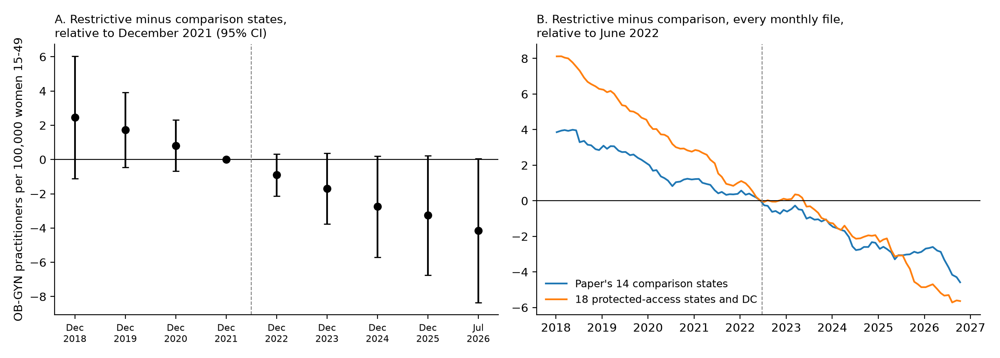

# The OB-GYN workforce gap in states that banned abortion predates *Dobbs*: a replication and four-year follow-up

**Nathan Sutton**, independent researcher. Correspondence: nasutton@gmail.com. ORCID: [0000-0003-1441-5461](https://orcid.org/0000-0003-1441-5461). Preprint, October 2026.

## Abstract

**Importance.** A widely cited difference-in-differences study (Zhu et al., *JAMA Internal Medicine*, 2025) found that OB-GYN practitioner supply fell 4.2 percent in the 12 states that banned abortion after *Dobbs v Jackson Women's Health Organization* relative to 14 comparison states, with two years of follow-up. A descriptive study of the same registry found no disproportionate change.

**Objective.** To reproduce the study from public data, extend it to four years of follow-up, and examine the identifying assumption with the full monthly series.

**Design, setting and data.** Replication and extension using every monthly file of the National Plan and Provider Enumeration System (NPPES) from January 2018 to October 2026 (106 files), the study's own states, taxonomy codes, denominators and regression. We then varied the three design choices that have been questioned: file timing, the comparison group and fixed population denominators.

**Results.** The replication matches the published estimate (-3.17 vs -3.0 per 100,000 women aged 15 to 49; P = .03). With two more years the estimate grows to -3.8 (P = .04). But the gap between the two groups of states was widening at a steady rate before *Dobbs*: year-by-year estimates relative to December 2021 fall from +2.5 in 2018 to -4.1 in 2026 along a near-straight line. The monthly gap widened by 0.93 per 100,000 a year before the decision and 0.87 after, with no break in June 2022. The study's own pre-trend test, reported only as non-significant, implies -0.83 per 100,000 a year, which by itself produces -2.8 of the -3.2 estimate. Across consistent file timing, protected-access comparison states and annual population estimates, the estimate ranges from -2.6 to -4.7 and the extrapolated pre-*Dobbs* trend accounts for 88 to 143 percent of it. Protected-access comparison states fail the pre-trend test outright (P = .001).

**Conclusions and relevance.** The relative decline in OB-GYN supply in ban states is real in the registry but began before *Dobbs* and continued at the same pace after it. The published estimate and the published null finding are both consistent with this pre-existing divergence. Neither establishes an effect of the bans on where OB-GYNs practice.

## Introduction

Whether abortion bans drive obstetrician-gynecologists and midwives out of the states that enact them matters for maternity care access in states that already have the fewest OB-GYNs per capita. Three studies of the first two years after the June 2022 *Dobbs* decision disagree. Zhu et al. counted OB-GYN practitioners in NPPES per 100,000 reproductive-age women and estimated a difference-in-differences decline of 3.0 per 100,000 (4.2 percent) in the 12 states with the most restrictive post-*Dobbs* laws relative to 14 comparison states (1). They reported that "before the *Dobbs* decision, OBGYN practitioner supply patterns were similar" and that a pre-period test of parallel trends was not significant. Staiger et al., using quarterly NPPES counts and shares of physicians, found that counts "evolved similarly" in ban, threatened and protected states and "no disproportionate changes" (2). Strasser et al., using Medicare enrollment records, found no significant change in OB-GYNs entering ban states (3). Correspondence on the first study questioned its choice of counterfactual (4, 5).

Both NPPES studies name a two-year follow-up as a limit (1, 2). NPPES is public and published monthly, so the first study can be rebuilt exactly and followed for longer, and its identifying assumption can be examined at monthly resolution rather than in four annual pre-period files.

## Methods

**Data.** We used every monthly NPPES full-replacement file from January 2018 to October 2026, assembled into a versioned history of each provider record (6). A practitioner is counted in a state on a file's date if their record on that date is an individual (entity type 1) whose primary practice address is in the state and whose primary taxonomy, the slot the record flags as primary, is one of the 11 OB-GYN codes in the study's eTable 1 (nine obstetrics and gynecology physician codes, midwife and advanced practice midwife).

**Replication.** We followed the published design exactly: the December files of 2018 to 2023 and the July 2024 file; the post-period beginning December 2022; the 12 most restrictive states and 14 comparison states (1); the female population aged 15 to 49 from the 2017-2021 American Community Survey 5-year estimates as a fixed denominator; and a regression of the state rate on a treatment indicator with state and year fixed effects and standard errors clustered by state, estimated with `pyfixest`. We reproduced the sensitivity samples in the study's Table (without Texas; without Texas and Wisconsin) and the three analyses its supplement describes (population weights; adding family physicians and nurse practitioners with an obstetric taxonomy; a primary care falsification test).

**Extension.** The extended panel adds the December 2024 and December 2025 files and ends with July 2026, as the original ended with July 2024. Everything else is unchanged.

**Pre-trends.** We estimated the event-study form of the same regression (one treatment interaction per file, relative to December 2021), reproduced the study's pre-period test (a linear trend for the restrictive states in the four pre-period files, with state and year fixed effects), and computed the estimate that trend alone would produce: its slope times the distance in years between the mean post-period and mean pre-period file dates. We also computed the mean state rate of each group in all 106 monthly files and fitted linear slopes to the gap before and after June 24, 2022.

**Design variations.** Each changes one element of the published design. *File timing*: December files only, ending in December 2023 or with December 2024 in place of July 2024; and the January, April, July and October files from January 2018 to July 2024 (27 files, post-period from July 2022, file-date fixed effects). *Comparison group*: the 18 states and the District of Columbia rated protective, very protective or most protective in the Guttmacher Institute's state policy data as of July 2024 (7), the source and date the original study used for its groups. *Denominators*: the Census Bureau's July 1 estimate of women aged 15 to 49 for each year (2020-census-based intercensal estimates for 2018-2019 and vintage 2025 estimates for 2020-2025; 2025 for July 2026). For each variation we report the difference-in-differences estimate and the same pre-trend test on that panel's pre-period files.

## Results

**Replication.** The restrictive states' mean rates match the published values exactly (71.5 before, 77.8 after) and the comparison states' are 0.2 to 0.3 lower (93.0 and 102.5 vs 93.3 and 102.7). The estimate is -3.17 per 100,000 (95% CI, -5.97 to -0.37; P = .03; -4.4 percent) against the published -3.0 (-5.9 to -0.2; P = .04), and -3.34 and -3.38 in the two sensitivity samples against -3.2 and -3.2. The study's population table (eTable 2) prints the values of Mississippi and Missouri, and of Nevada and New Hampshire, swapped; the published means and standard deviations are reproduced only with the correct values, so the error is confined to the printed table. Of the unreported supplementary analyses, population weighting gives -2.7 (P = .05), adding family physicians and nurse practitioners gives -3.0 (P = .08), and the primary care falsification estimate is -5.4 (95% CI, -14.6 to 3.9), too imprecise to rule out a primary care decline as large in relative terms as the OB-GYN estimate.

**Extension.** Through July 2026 the estimate is -3.80 (95% CI, -7.48 to -0.12; P = .04; -5.3 percent); -4.0 without Texas, -3.9 without Texas and Wisconsin (P = .05), and -3.4 weighted.

**Pre-trends.** The event-study estimates relative to December 2021 are +2.5, +1.7 and +0.8 in December 2018, 2019 and 2020, then -0.9, -1.7, -2.8 and -3.3 in December 2022 to 2025 and -4.1 in July 2026 (Figure 1A). None of the pre-period estimates is individually significant, as the study reported, but they lie on the same line as the post-period estimates. The study's pre-period test gives a differential trend of -0.83 per 100,000 a year (95% CI, -1.99 to 0.33; P = .15). Continued at that rate, the trend alone produces -2.8 of the -3.2 estimate and -3.7 of the extended -3.8. In the monthly series (Figure 1B), the comparison states' mean rate rose from 86.4 to 112.5 per 100,000 and the restrictive states' from 67.1 to 84.8 between January 2018 and October 2026; the gap widened from 19.3 to 27.7, at 0.93 per 100,000 a year before *Dobbs* and 0.87 after.

**Design variations** (Table 1). Consistent file timing moves the estimate to between -2.6 and -3.0; the July 2024 file adds to the published estimate but does not create it. Annual population estimates give -2.6 (P = .04), about a fifth smaller. Protected-access comparison states give a larger estimate, -4.7 (P = .001), but against them the restrictive states were already falling behind by 1.8 per 100,000 a year before *Dobbs* (P = .001); this trend alone produces -5.9. Against these states the monthly gap paused for about a year after June 2022 and then resumed its earlier slope (1.83 per 100,000 a year before, 1.51 after; Figure 1B). In every variation the pre-*Dobbs* trend alone produces between 88 and 143 percent of the estimate.

**Table 1.** Difference-in-differences estimates of OB-GYN practitioners per 100,000 women aged 15 to 49, restrictive minus comparison states, and the pre-*Dobbs* differential trend in each panel.

| Panel | Estimate (95% CI) | P | Pre-*Dobbs* trend per year (P) | Trend alone |
|---|---|---|---|---|
| Published (Zhu et al.) | -3.0 (-5.9 to -0.2) | .04 | not reported | |
| Replication: Dec 2018-2023, Jul 2024 | -3.17 (-5.97 to -0.37) | .03 | -0.83 (.15) | -2.78 |
| December files, 2018-2023 | -2.55 (-5.07 to -0.03) | .05 | -0.83 (.15) | -2.48 |
| December files, 2018-2024 | -3.03 (-5.95 to -0.12) | .04 | -0.83 (.15) | -2.89 |
| Quarterly files, Jan 2018-Jul 2024 | -3.03 (-5.85 to -0.22) | .04 | -0.92 (.09) | -3.11 |
| Protected-access comparison states | -4.74 (-7.38 to -2.10) | .001 | -1.76 (.001) | -5.91 |
| Annual population estimates | -2.58 (-5.09 to -0.08) | .04 | -0.77 (.16) | -2.56 |
| Quarterly, protected-access, annual population | -5.25 (-7.45 to -3.05) | <.001 | -2.23 (<.001) | -7.50 |
| Extended: Dec 2018-2025, Jul 2026 | -3.80 (-7.48 to -0.12) | .04 | -0.83 (.15) | -3.65 |
| Extended, protected-access comparison states | -6.30 (-9.73 to -2.86) | .001 | -1.76 (.001) | -7.77 |
| Extended, annual population estimates | -3.08 (-6.17 to 0.01) | .05 | -0.77 (.16) | -3.37 |

State and file-date fixed effects; standard errors clustered by state. "Trend alone" is the pre-period differential trend times the distance in years between the mean post-period and pre-period file dates: the estimate a continuation of the pre-*Dobbs* divergence would produce with no effect of the decision.

{width=full}

**Figure 1.** (A) Event-study estimates of the restrictive-minus-comparison difference in OB-GYN practitioners per 100,000 women aged 15 to 49, relative to December 2021, with 95% confidence intervals; extended panel, published design. (B) Difference between the mean state rates of the restrictive states and each comparison group in every monthly NPPES file, relative to June 2022. The dashed line marks the *Dobbs* decision.

## Discussion

The published estimate replicates from public data to within a few tenths per 100,000, and it grows with two more years of follow-up. Read alone, that would strengthen the finding. But the year-by-year and monthly series show that OB-GYN supply in the restrictive states was falling behind the comparison states at the same rate for four years before *Dobbs* as in the four years after it. A difference-in-differences comparison of mean levels before and after a date converts any steady divergence into an apparent effect that grows with the length of follow-up, which is what the extension shows. The study's parallel-trends test was not significant, but with 26 states and four pre-period files it had little power, and its point estimate accounts for nearly all of the effect (8).

This reading reconciles the two NPPES studies. The decline relative to the comparison states is present in the registry, as Zhu et al. found; and nothing changed at *Dobbs*, as Staiger et al. found with counts. None of the design variations that have been questioned removes the divergence. Consistent file timing and annual denominators shrink the estimate by up to a fifth; a protected-access comparison group enlarges it, but only because the restrictive states were falling behind those states twice as fast before the decision. The year-long pause in that gap after June 2022 is the opposite of what an exodus from ban states would produce.

The results do not show that the bans had no effect. An effect of the bans that happened to replace an earlier cause of the same size would look the same in these data, and the earlier divergence itself (in population growth, physician supply or practice economics across these states) is unexplained. Designs that allow for differential trends, such as state-specific trends, synthetic controls or bounds on violations of parallel trends (9), are natural next steps. What the data do not support is reading the published estimate as a migration of OB-GYNs caused by the bans.

**Limitations.** NPPES records the practice address a clinician last reported, and updates can lag; a validation exercise found location errors for about 20 percent of OB-GYNs named in media reports of moves (2). Clinicians practicing in more than one state are counted once. We follow the original study's taxonomy codes, groups and estimator; we read only the opening of the published correspondence (4, 5), and its proposed specifications may differ from the variations tested here. The nurse practitioner codes in one supplementary analysis are our reading of the study's description.

## Conclusions

The relative decline in OB-GYN supply in states that banned abortion after *Dobbs* is visible in NPPES, replicable, and larger after four years than after two. It began before the decision and has continued at the same pace since. Estimates of the effect of the bans on OB-GYN location need designs that account for this pre-existing divergence.

## Declarations

**Data and code availability.** All data are public. The monthly NPPES history, the reference data (state groups, taxonomy codes, population estimates with checksums and archived source URLs) and the notebook that produces every number, table and figure in this paper are at https://github.com/nathansutton/nppes-over-time, directory `research/dobbs-obgyn-workforce` [COMMIT HASH]. The notebook runs end to end in about a minute.

**Ethics.** The study uses only public, provider-level administrative data and aggregate population estimates and involves no human participants; institutional review was not required.

**Funding.** None.

**Competing interests.** None declared.

**Use of AI tools.** The data pipeline, analysis code and a first draft of this manuscript were written with the assistance of an AI coding assistant (Claude, Anthropic). The author reviewed the code, reran the analysis and is responsible for the content.

## References

1. Zhu JM, Huntington A, McConnell KJ, Whelan AM, Aaron R, Rodriguez MI. Post-*Dobbs* decision changes in obstetrics and gynecology clinical workforce in states with abortion restrictions. *JAMA Intern Med*. 2025;185(5):598-600. doi:10.1001/jamainternmed.2024.8149
2. Staiger B, Bolotnyy V, Borrero S, Rossin-Slater M, Van Parys J, Myers C. Obstetrician and gynecologist physicians' practice locations before and after the *Dobbs* decision. *JAMA Netw Open*. 2025;8(4):e251608. doi:10.1001/jamanetworkopen.2025.1608
3. Strasser J, Schenk E, Luo Q, Chen C. Lower obstetrician and gynecologist (OBGYN) supply in abortion-ban states, despite minimal state-level changes in the 2 years post-*Dobbs*. *Health Aff Sch*. 2024;2(12):qxae162. doi:10.1093/haschl/qxae162
4. Staiger B, Strasser J, Myers C. Methodological concerns in post-*Dobbs* OBGYN practitioner movement study. *JAMA Intern Med*. 2025;185(9):1175-1176. doi:10.1001/jamainternmed.2025.2914
5. Zhu JM, McConnell KJ, Rodriguez MI. In reply. *JAMA Intern Med*. 2025;185(9):1176. doi:10.1001/jamainternmed.2025.2920
6. Sutton N. nppes-over-time: a versioned monthly history of the National Plan and Provider Enumeration System. https://github.com/nathansutton/nppes-over-time
7. Guttmacher Institute. State policy data behind the interactive map of US abortion policies, as of July 11, 2024. Archived at https://web.archive.org/web/20240711154357/https://states.guttmacher.org/policies/admin/api/collections/get/states/?populate=1
8. Roth J. Pretest with caution: event-study estimates after testing for parallel trends. *Am Econ Rev Insights*. 2022;4(3):305-322. doi:10.1257/aeri.20210236
9. Rambachan A, Roth J. A more credible approach to parallel trends. *Rev Econ Stud*. 2023;90(5):2555-2591. doi:10.1093/restud/rdad018
